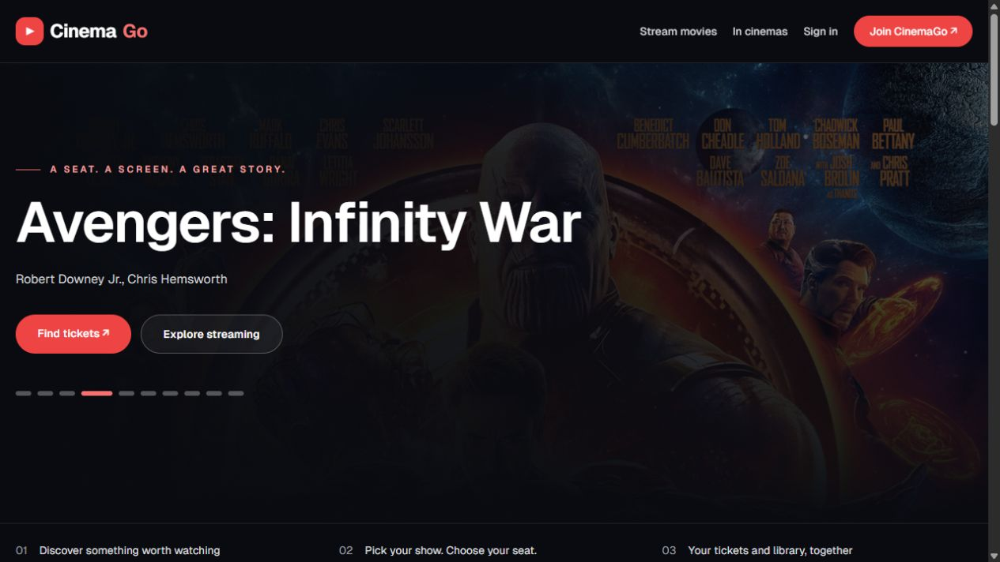

<div align="center">

# CinemaGo

### A seat. A screen. A great story.

Discover films, choose cinema seats, and keep your streaming library and tickets together.

[Live demo](https://cinemago.tahmidkhan.com.bd) · [Report an issue](https://github.com/tahmidkhanshuvo/CinemaGo/issues)

   

</div>



CinemaGo is an educational full-stack application by Tahmid Khan. Payments are simulated: the application records demo purchases and bookings without processing real cards. Configure media URLs only for content you are authorized to distribute. Free hosting may take a moment to wake after inactivity.

## Features

- A responsive movie homepage driven by the actual catalogue, with featured films, streaming titles, now-showing and upcoming shelves.
- Movie search and details, cinema showtimes, hall seat maps and server-calculated ticket prices.
- Account registration/sign-in, profile management, password changes, ticket history, streaming purchases and an owned library.
- Purchase-checked playback URLs and movie ratings.
- Administrator tools for movies, halls, showtimes and booking cancellation; every administrator controller requires the Admin role.

Seat booking runs in a PostgreSQL transaction with a per-showtime advisory lock. Competing requests cannot book the same seat. Cancellation releases only the seats belonging to that order. Streaming purchase/payment writes are atomic and serialized per account/movie. Unpublished and cinema-only films cannot be purchased as streaming titles. Public catalogue responses omit playback URLs.

## Run locally

Install **.NET SDK 10**, **Node.js 22**, and PostgreSQL. Use a dedicated development database.

Set API environment variables from the root `.env.example` in your shell or IDE. ASP.NET reads environment variables directly; it does not automatically load that example as a dotenv file. An ignored `CinemaGo.Api/appsettings.Development.local.json` may instead hold development-only settings using the same structure as `appsettings.json`.

```sh
# Configure ConnectionStrings__DefaultConnection and Jwt__SecretKey first.
dotnet restore CinemaGo.Api
dotnet run --project CinemaGo.Api --no-launch-profile --urls http://localhost:5000
```

For a local JSON override, set `ASPNETCORE_ENVIRONMENT=Development`. Use a random signing secret of at least 32 bytes. No built-in database password or signing secret is supplied.

```sh
cd frontend
npm ci
cp .env.example .env.local
npm run dev
```

Open `http://localhost:3000`. The frontend variable includes the `/api` suffix. Its value is public; private database and signing credentials belong only in the API process.

## Database and administrator setup

Startup preserves existing data and ensures the schema exists. It does not reset the database or seed demo accounts automatically. To populate a **new development database**, explicitly set `Database__SeedDemoData=true`, `Bootstrap__AdminEmail`, and a unique `Bootstrap__AdminPassword` of at least 12 characters. Seeding adds catalogue/hall/showtime data; turn the flag off after the initial setup. Existing accounts are not reset.

The legacy reset route is restricted to authenticated administrators, Development mode, and explicit `Database__AllowReset=true`. Leave that flag false. Previously published credentials remain in repository history and must be rotated at their providers; removing them from current source does not revoke them.

## Configuration

| Variable | Location | Purpose |
| --- | --- | --- |
| `ConnectionStrings__DefaultConnection` | API | Npgsql connection string; require TLS for a hosted database |
| `Jwt__SecretKey` | API | Required server-only signing secret, at least 32 bytes |
| `Jwt__ExpiryHours` | API | Token configuration; default token lifetime is 24 hours |
| `ASPNETCORE_ENVIRONMENT` | API | Production on hosting; Development only locally |
| `ASPNETCORE_URLS` | API | Listener; Docker exposes port 8080 |
| `Database__SeedDemoData` | API | Explicit initial demo data, off by default |
| `Database__EnsureDemoSchedule` | API | Optional rolling 30-day educational calendar in the dedicated Online demo screen; off by default |
| `Database__SeedOpenMovieDemo` | API | Add the free attributed 15-second open-movie streaming excerpt once; off by default |
| `Bootstrap__AdminEmail`, `Bootstrap__AdminPassword` | API | Explicit first administrator for demo seeding |
| `NEXT_PUBLIC_API_URL` | Frontend | Public API URL including `/api` |

## Repository map

| Path | Responsibility |
| --- | --- |
| `CinemaGo.Api/Controllers` | Public catalogue, auth, booking, OTT, profile and ratings |
| `CinemaGo.Api/Controllers/Admin` | Role-restricted management APIs |
| `CinemaGo.Api/Data` | EF Core mappings and explicit initial-data setup |
| `CinemaGo.Api/Models`, `DTOs` | Persistence entities and API response contracts |
| `frontend/src/app` | Next.js public, account, cinema, streaming and admin routes |
| `frontend/src/lib/api.ts` | Shared API client with bounded requests |
| `tests/CinemaGo.WorkflowChecks` | PostgreSQL-backed concurrency and ownership checks |

## API landmarks

| Endpoint | Purpose |
| --- | --- |
| `GET /healthz` | Database-aware readiness |
| `POST /api/auth/register`, `/api/auth/login` | Account access |
| `GET /api/movies/home`, `/api/movies`, `/api/movies/{slug}` | Public catalogue |
| `GET /api/cinema/showtimes`, `/api/cinema/showtimes/{id}` | Showtimes and seats |
| `PUT /api/profile/password` | Change your own password with current-password verification; invalidate older sessions |
| `POST /api/cinema/book` | Authenticated demo ticket booking |
| `POST /api/ott/{movieId}/purchase` | Atomic demo streaming purchase |
| `GET /api/ott/purchases`, `/api/ott/{movieId}/watch` | Owned library and authorized playback |
| `GET /api/profile/purchases` | Envelope containing both `ottPurchases` and `ticketOrders` |
| `/api/admin/*` | Admin role required |

## Verification

```sh
dotnet build CinemaGo.Api
# Set CINEMAGO_TEST_CONNECTION to a PostgreSQL test connection.
dotnet run --project tests/CinemaGo.WorkflowChecks
cd frontend
npm run lint
npm run build
```

The workflow checks create an explicitly qualified, uniquely named `cinemago_test_*` schema and remove only that schema afterward. They exercise concurrent booking, foreign-hall/duplicate seat rejection, price/payment consistency, cancellation isolation, unpublished-title restrictions, purchase ownership, concurrent OTT purchases, administrator role declarations, and password ownership/session invalidation. CI uses its own PostgreSQL service. Frontend lint currently reports legacy type/effect warnings; there are no lint errors.

Public showtime discovery defaults to the next 200 scheduled performances of published movies in active halls. Explicit date filters still support historical lookup. Availability counts enabled seats. This keeps years of historical records out of the default booking view without deleting them.

For an interactive educational deployment, `Database__EnsureDemoSchedule=true` fills missing dates for the next 30 days in **CinemaGo Demo Screen / Online demo**, using published catalogue titles and 16 demo seats. It runs at startup, checks existing dates under a database lock, preserves cancellations/history, and never modifies other halls. Disable or deactivate that demo screen for a real cinema. The schedule represents simulated bookings, not physical performances.

The optional free streaming sample is a **15-second excerpt of Big Buck Bunny**, © 2008 Blender Foundation / [www.bigbuckbunny.org](https://peach.blender.org/), licensed [CC BY 3.0](https://creativecommons.org/licenses/by/3.0/). It is shortened from the [official original film download](https://peach.blender.org/download/) for playback testing; the local MP4 and original title-card SVG are under `frontend/public/demo/`. The film attribution is shown in its description and player. `Database__SeedOpenMovieDemo=true` adds this educational catalogue entry idempotently. Existing titles without media remain in the catalogue, with purchase disabled until a usable stream is configured. Public movie details do not expose unpublished titles or playback URLs.

Change an existing account's password under **My account → Account security**. The current password is required; the replacement must contain at least 12 characters and fit within bcrypt's 72-byte limit. Older sessions stop working after a change. The deployment introducing credential versions also requires existing sessions to sign in again. Rotate any credentials exposed in earlier repository history through their provider; removing them from current source does not revoke them.

## Deployment

The existing Render Docker service builds `CinemaGo.Api/Dockerfile` with the repository root as its context. Set API secrets in Render and use `/healthz` for readiness. The existing Vercel project uses root `frontend`, the Next.js preset, and `NEXT_PUBLIC_API_URL=https://cinemago-bpdf.onrender.com/api`.

After deployment, verify catalogue loading, account access, seat selection, ticket history, owned-library playback and administrator access. Preserve existing data and retain the previous successful deployment for rollback. Use disposable test data for write checks. Payments in this project remain a demo.
